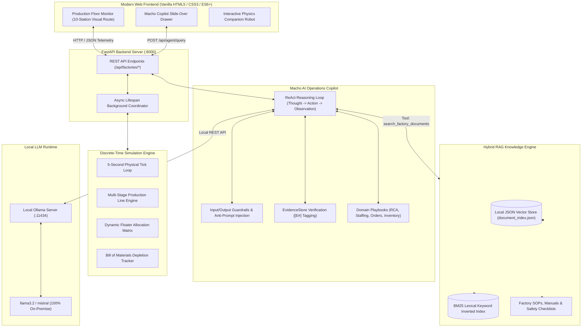
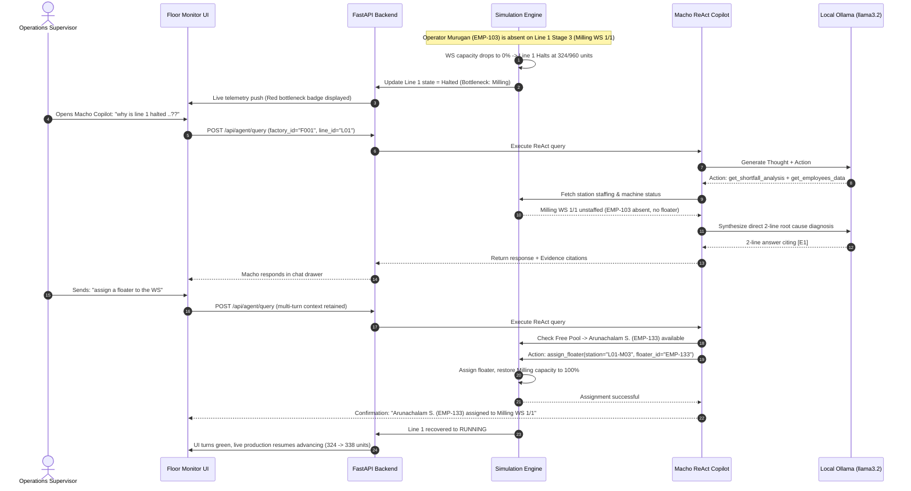
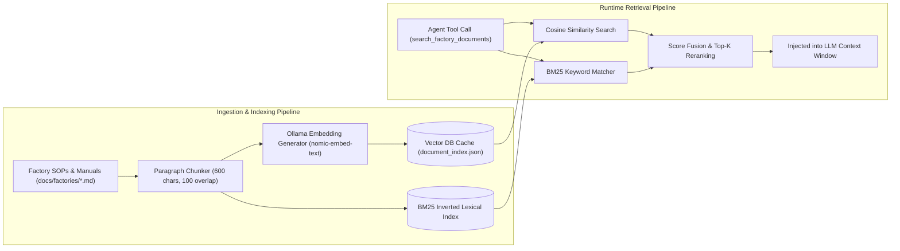
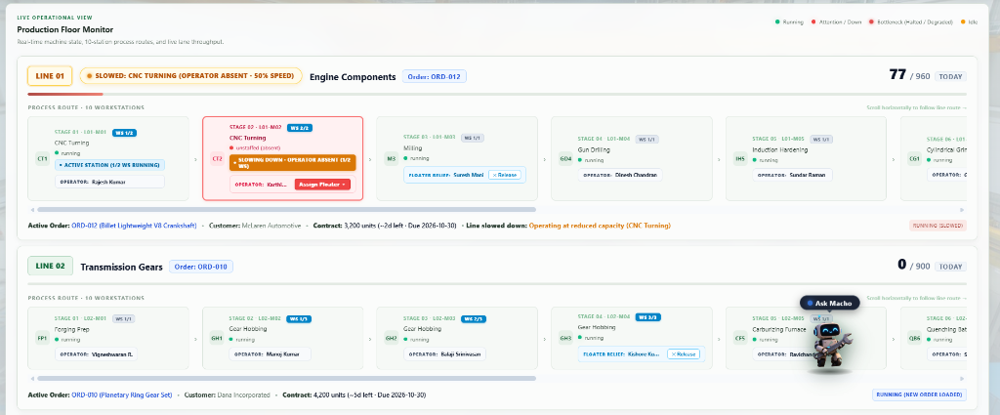
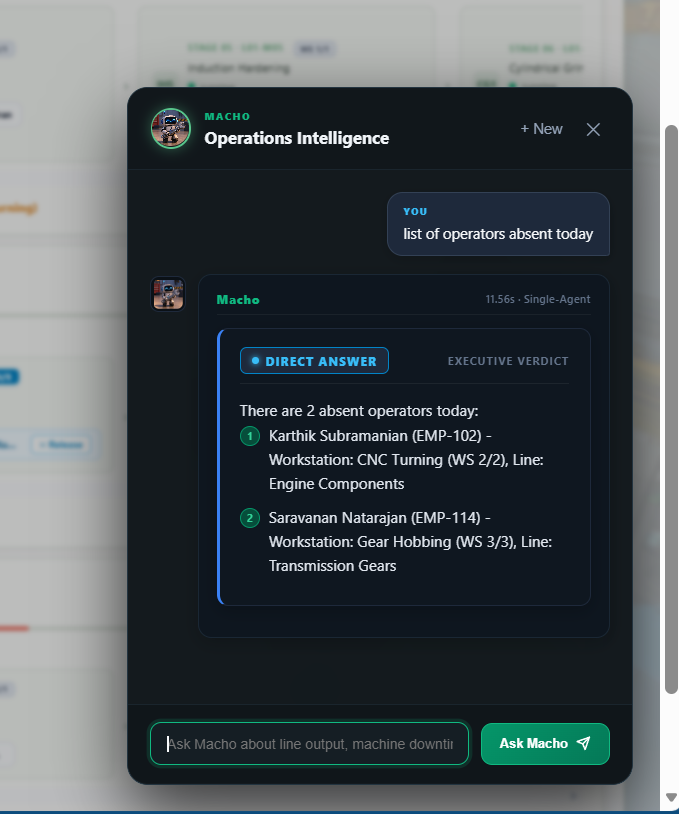
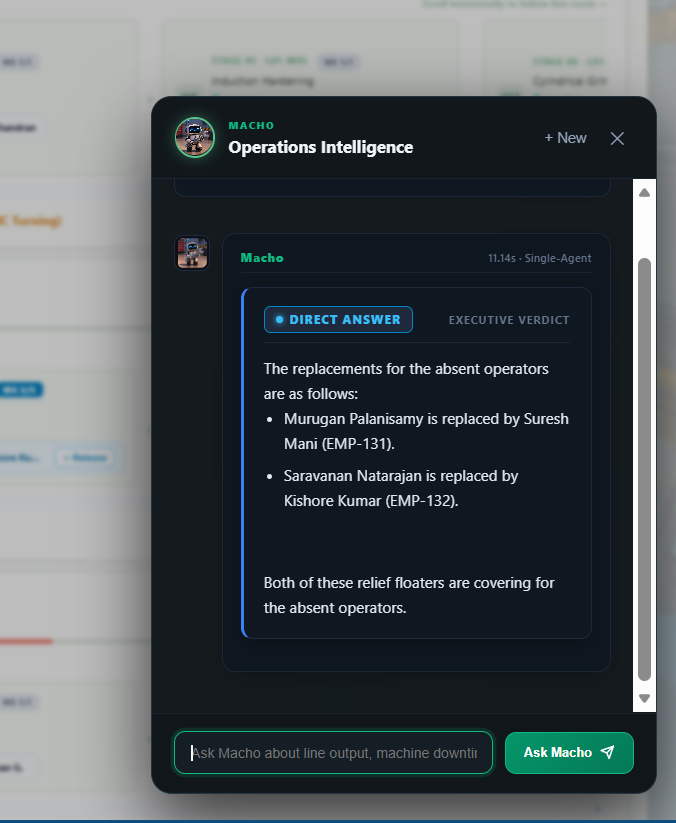
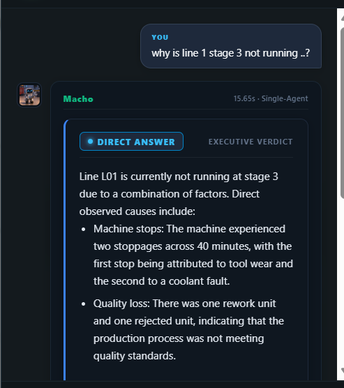
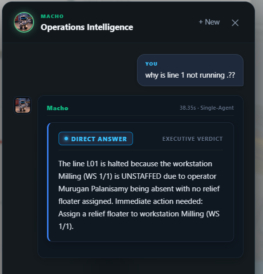
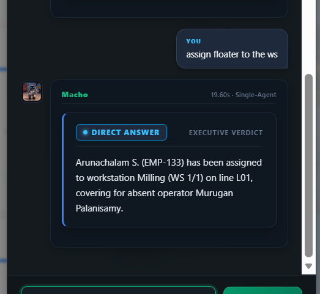
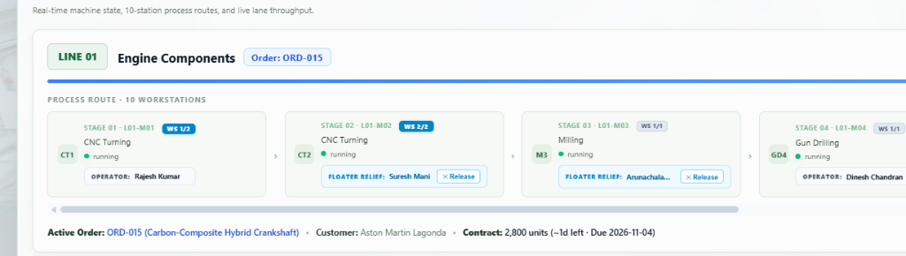

# FactoryOS V2 — Autonomous Industrial Operations & Macho AI Copilot

FactoryOS V2 is an autonomous, full-stack industrial operations intelligence platform and simulation environment. It combines discrete-time manufacturing floor telemetry, multi-order batch scheduling, dynamic shift workforce allocation, and **Macho** — a private, local ReAct AI Operations Copilot powered strictly by **Ollama**, featuring a hybrid **RAG (Retrieval-Augmented Generation) & Vector Database** knowledge engine.

---

## 🏭 1. About the Project

### The Problem in Modern Manufacturing
Industrial discrete manufacturing floors (automotive components, precision gearing, aerospace assemblies) operate under tight delivery deadlines and high asset utilization. In traditional plants:
1. **Unplanned Bottlenecks:** When a machine operator is absent on a single-workstation bottleneck stage (e.g., Milling `WS 1/1`), the entire sequential production line halts immediately. Supervisors often take 30–60 minutes to notice, diagnose, and dispatch a certified replacement.
2. **Data Silos & Noise:** Telemetry (machine alarms, scrap rates, downtime logs) is scattered across PLC logs, paper shift rosters, ERP inventory databases, and PDF maintenance binders.
3. **Cloud & Privacy Risks:** Enterprise manufacturers cannot stream proprietary telemetry, internal scrap rates, or workforce records to third-party cloud LLMs due to intellectual property and regulatory boundaries.

### The Solution: FactoryOS V2
FactoryOS V2 bridges physical floor telemetry and autonomous operational action. It pairs a **5-second discrete-time simulation engine** with **Macho**, an autonomous on-premise operations copilot:
- **100% Local & Private:** Powered by **Ollama** running local open-weights LLMs (`llama3.2`, `mistral`) inside the factory firewall with zero cloud data transmission.
- **Root Cause Determination in Seconds:** Eliminates multi-part corporate boilerplate by providing precise, 2-line root cause diagnosis and recommending instant remediations.
- **Autonomous Floor Actions:** Not just an informational chatbot—Macho executes real operational actions (e.g., querying the standby Free Pool and autonomously deploying certified relief floaters to halted workstations).
- **Multi-Batch Scheduling:** Coordinates sequential multi-order customer contracts, automatically tracking quotas and enabling 1-click batch changeovers.
- **Evidence-Grounded (Zero Hallucination):** Every claim is tagged with verified runtime evidence (`[E#]`), guaranteed by deterministic input/output guardrails.

---

## 🛠️ Complete Technology Stack & Architecture

FactoryOS V2 is built with a strictly decoupled, production-grade architecture combining local generative AI, vector retrieval, and discrete-time physical manufacturing simulation:

```
┌─────────────────────────────────────────────────────────────────────────────┐
│                       MODERN WEB FRONTEND (VANILLA JS/CSS)                  │
│   Floor Monitor  │  Interactive Line Routes  │  Macho Copilot Slide Drawer  │
└──────────────────────────────────────┬──────────────────────────────────────┘
                                       │ HTTP / JSON
┌──────────────────────────────────────▼──────────────────────────────────────┐
│                           FASTAPI BACKEND SERVER                            │
│  REST Telemetry Endpoints  │  Batch Order Dispatcher  │  Simulator Lifespan │
└──────────┬───────────────────────────┬───────────────────────────┬──────────┘
           │                           │                           │
┌──────────▼──────────┐     ┌──────────▼──────────┐     ┌──────────▼──────────┐
│  DISCRETE SIMULATOR │     │  MACHO AI COPILOT   │     │  HYBRID RAG ENGINE  │
│  - 5-sec Tick Loop  │     │  - ReAct Loop       │     │  - Vector Embeddings│
│  - Machine Health   │     │  - Multi-Turn Memory│     │  - BM25 Lexical     │
│  - BOM Material Use │     │  - Input Guardrails │     │  - SOP & Manual Doc │
│  - Shift Workforce  │     │  - Evidence Engine  │     │  - Cosine Search    │
└─────────────────────┘     └──────────┬──────────┘     └─────────────────────┘
                                       │ REST API (:11434)
                            ┌──────────▼──────────┐
                            │    LOCAL OLLAMA     │
                            │  (llama3.2/mistral) │
                            │  100% Private / No  │
                            │  Cloud Data Leakage │
                            └─────────────────────┘
```

### 1. Local Large Language Model (LLM) — Ollama
* **Role:** Powers all generative reasoning, structured ReAct tool selection, and conversational synthesis.
* **Technology:** **Ollama** running locally on `http://127.0.0.1:11434`.
* **Models Supported:** `llama3.2:latest`, `mistral:latest`, `phi3:latest`, `qwen3`.
* **Zero Cloud Dependency:** All operational logs, workforce rosters, machine telemetry, and proprietary production data stay 100% local within the plant firewall. Deterministic hardcoded bypasses have been completely removed.

### 2. Retrieval-Augmented Generation (RAG) & Vector Database — ChromaDB
* **Location:** [v2/rag.py](file:///e:/Vishwa/learning/agent/v2/rag.py)
* **Vector Engine:** **ChromaDB** persistent vector database backed by SQLite on disk (`v2/data/chroma/chroma.sqlite3`).
* **Document Knowledge Store:** Ingests factory SOPs, machine operating manuals, safety protocols, and restart checklists from `docs/factories/`.
* **Semantic Chunking:** Custom chunking algorithm splits documentation by paragraphs with token overlap (`max_chars=600`, `overlap=100`).
* **Hybrid Search Strategy:**
  1. **ChromaDB Vector Embeddings:** Zero-external-dependency Ollama embedding function (`OllamaChromaEmbeddingFunction`) generates dense vectors via local Ollama endpoint (`http://127.0.0.1:11434/api/embeddings`) with cosine distance indexing (`hnsw:space: cosine`).
  2. **Metadata Filtering:** Multi-tenant scoping filters chunks by factory boundary: `where={"factory_id": {"$in": [factory_id, "shared"]}}`.
  3. **BM25 / TF-IDF Lexical Fallback:** Offline lexical search for exact equipment codes (e.g. `CNC Turning`, `L01-M03`) ensuring high keyword precision if offline.
* **Tool Integration:** Exposed to the agent as `search_factory_documents` for real-time operating manual verification.

### 3. Agent Reasoning Engine & Tool Registry
* **Location:** [v2/harness.py](file:///e:/Vishwa/learning/agent/v2/harness.py), [v2/tools.py](file:///e:/Vishwa/learning/agent/v2/tools.py), [v2/skills/__init__.py](file:///e:/Vishwa/learning/agent/v2/skills/__init__.py)
* **ReAct Architecture:** Implements a dynamic **Thought → Action → Observation** execution loop.
* **Anti-Hallucination Evidence Engine:** Every tool execution registers structured evidence (`E1`, `E2`, etc.) in the `EvidenceStore`. Claims made by the model must cite indexed evidence tags `[E#]`.
* **Multi-Turn Conversation Memory:** Maintains rolling conversation history (`role: "user"`, `role: "assistant"`) across up to 20 turns, enabling sequential multi-prompt debugging and autonomous actions.
* **Domain Skills & Dynamic SOP Injection:** Automatically matches queries to specialized skill playbooks:
  - `Root Cause Analysis (RCA)`: 5-Whys diagnostic procedure prioritizing staffing bottlenecks before mechanical failure searches.
  - `Shift Workforce Staffing & Attendance Management`: Standby pool vs. deployed floater resolution.
  - `Manufacturing Work Order & Queue Management`: Sequential multi-day batch progress and dispatching.
  - `Material Shortage & Supply Chain Assessment`: BOM starvation analysis.
  - `Preventative Maintenance & Equipment Health`: Service logs and repair timestamps.
* **Multi-Agent Hierarchical Supervisor:** Optional multi-agent mode ([v2/multi_agent/](file:///e:/Vishwa/learning/agent/v2/multi_agent/)) routing queries across dedicated domain specialist agents (Operations Specialist, Workforce Specialist, Inventory Specialist, Maintenance Specialist) with consensus synthesis.

### 4. High-Performance REST API
* **Location:** [v2/api.py](file:///e:/Vishwa/learning/agent/v2/api.py)
* **Framework:** **FastAPI** with **Uvicorn** ASGI server.
* **Validation:** **Pydantic V2** models for strict request/response parameter validation and type safety.
* **Core Endpoints:**
  - `GET /api/factories`: Multi-plant metadata (Automotive, Textiles, Electronics).
  - `GET /api/factories/{id}/production`: Real-time line throughput, achieved units, and shortfall.
  - `GET /api/factories/{id}/orders`: Multi-batch contract schedules, completed orders, active orders, and next in queue.
  - `POST /api/factories/{id}/orders/dispatch-next`: 1-click batch loader for next queued work order.
  - `GET /api/factories/{id}/employees`: Real-time shift roll-call, absentees, and standby Free Pool roster.
  - `POST /api/factories/{id}/employees/assign-floater`: Allocates a relief floater to an unstaffed machine.
  - `POST /api/factories/{id}/employees/unassign-floater`: Releases a relief floater back to the Free Pool.
  - `POST /api/agent/query`: Single-agent ReAct or multi-agent supervisor copilot investigation endpoint.

### 5. Discrete-Time Physical Simulation Engine
* **Location:** [v2/simulator.py](file:///e:/Vishwa/learning/agent/v2/simulator.py)
* **Lifecycle:** Runs as an asynchronous background task within FastAPI's lifespan context manager, ticking every 5 seconds.
* **Simulation Mechanics:**
  - **Sequential & Parallel Routing:** Models stages with single (`WS 1/1`) or multiple parallel workstations (`WS 2/2`, `WS 3/3`). Halts lines if a single-workstation stage fails, or degrades line speed proportionally for parallel stages.
  - **Dynamic Workforce Allocation:** Simulates absent operators and bottleneck resolution when floaters are deployed.
  - **Bill of Materials (BOM) Consumption:** Consumes raw materials per unit produced and halts lines on material starvation.
  - **Sporadic Breakdowns & Cooldowns:** Stochastic Poisson-like machine failures with 20-tick service recovery and plant-wide cooldowns.
  - **Quality Inspection Simulation:** Per-unit defect inspection tracking rework and rejection scrap rates.

### 6. Modern Frontend Dashboard
* **Location:** [v2/frontend/](file:///e:/Vishwa/learning/agent/v2/frontend/)
* **Stack:** Vanilla **HTML5, CSS3, ES6+ JavaScript** (zero bloated node_modules or build steps).
* **UI Features:**
  - Glassmorphic dark/light operations dashboard.
  - Interactive 10-station horizontal process route visualizer with live status dots.
  - Draggable, interactive Macho companion robot with pointer-capture physics and position persistence (`localStorage`).
  - Slide-over Operations Intelligence Drawer with live response streaming and chat bubbles.
  - 1-Click Floater Dispatch & Roster Management modal.

---

## 🗂️ Project Directory Structure

```text
e:\Vishwa\learning\agent\
├── docs/
│   ├── factories/             # Operating manuals, safety protocols, and machine recovery SOPs (RAG knowledge base)
│   └── screenshots/           # UI walkthrough and incident recovery screenshots
├── v2/
│   ├── api.py                 # FastAPI REST application & simulator lifespan coordinator
│   ├── simulator.py           # Discrete-time industrial simulation engine (5s tick loop)
│   ├── harness.py             # ReAct Agent loop, prompt manager & anti-hallucination guardrails
│   ├── tools.py               # 12 allowlisted inspection & operational action tools
│   ├── rag.py                 # Hybrid RAG engine (Vector embeddings + BM25 keyword search)
│   ├── guardrails.py          # Input/output security, sanitization & citation verification
│   ├── evals.py               # Benchmark test suite for agent accuracy & citation groundedness
│   ├── multi_agent/           # Hierarchical Multi-Agent Supervisor & specialist agents
│   ├── skills/                # Domain playbooks (RCA, Staffing, Orders, Inventory, Maintenance)
│   ├── data/
│   │   ├── factories/         # Multi-factory data (F001 Automotive, F002 Textiles, F003 Electronics)
│   │   └── document_index.json# Pre-computed vector embeddings cache
│   └── frontend/
│       ├── index.html         # Live Operations Floor Monitor
│       ├── app.js             # Real-time state synchronization, drawer & companion controller
│       ├── style.css          # Core design system & layout tokens
│       └── copilot.css        # Slide-over copilot drawer & chat styling
└── README.md                  # Complete platform documentation
```

---

## 🔄 2. System Flowcharts & Operational Workflows

### 1. End-to-End System Architecture Flowchart
This flowchart captures the complete data loop between the interactive web dashboard, the asynchronous FastAPI backend, the physical simulation loop, the ReAct AI copilot, and the local Ollama LLM runtime:



---

### 2. Autonomous Incident Triage & Floater Dispatch Sequence
The following sequence diagram maps the live production stoppage scenario and autonomous floater dispatch resolution:



---

### 3. Hybrid RAG Knowledge Retrieval Pipeline
This flowchart illustrates how unstructured plant documentation is vectorized, indexed, and retrieved during tool execution:



---

### 4. Operational Step-by-Step Workflows

#### Workflow A: Bottleneck Detection & Autonomous Floater Dispatch
1. **Bottleneck Occurrence:** A primary operator is marked absent or a floater is unassigned. If the workstation is a single-machine bottleneck (`WS 1/1`), stage capacity drops to `0%`, and the line halts immediately.
2. **Floor Alerting:** The UI renders an urgent red badge (`BOTTLENECK: [STAGE] (OPERATOR ABSENT)`), turns the stage border red, and halts the active order counter.
3. **Macho Diagnostic Inquiry:** The supervisor opens the Macho drawer and asks for the stoppage cause. Macho triggers `get_shortfall_analysis`, `get_employees_data`, and `get_machine_status`.
4. **2-Line Precision Diagnosis:** Macho delivers a direct, two-line answer identifying the unstaffed workstation, the absent employee ID, and recommending immediate floater assignment.
5. **Autonomous Dispatch:** The supervisor instructs Macho to assign a floater. Macho validates cross-training certifications, selects the top available standby operator from the Free Pool, and calls `assign_floater`.
6. **Recovery & Line Resumption:** The workstation returns to operational capacity, the line turns green (`RUNNING`), and production units immediately begin incrementing.

#### Workflow B: Batch Work Order Loading & Multi-Line Scheduling
1. **Target Quota Monitoring:** Each line runs an active order towards its batch target (e.g., `960` units for `ORD-015`, `900` units for `ORD-013`).
2. **Order Completion Detection:** Once cumulative units meet or exceed the batch target, the line enters `COMPLETED` state.
3. **Queue Selection:** The dispatcher inspects pending work orders in queue for that production line.
4. **1-Click Batch Loading:** Pressing `[► Load: ORD-XXX]` calls `POST /api/factories/{id}/orders/dispatch-next`.
5. **Telemetry Reset:** The active order indicator updates to the new contract, active batch units reset to 0, and sequential workstation flow begins immediately.

#### Workflow C: ReAct Multi-Turn Reasoning & Anti-Hallucination Protocol
1. **Input Guardrails:** User prompt is scrubbed for prompt injections and malicious system overrides.
2. **Skill Playbook Injection:** The query is classified to match domain playbooks (`RCA`, `Staffing`, `Orders`, `Inventory`, `Maintenance`).
3. **ReAct Execution Cycle:** The LLM executes sequential `Thought` and `Action` steps against 12 allowlisted Python inspection tools.
4. **Evidence Indexing:** Raw outputs are scrubbed of internal hashes and registered into `EvidenceStore` with numbered keys `[E#]`.
5. **Synthesis & Citation Verification:** The LLM produces its final response citing verified evidence tags. Output guardrails check that every claim matches an existing `[E#]`.
6. **Context Persistence:** Conversation turns are appended to multi-turn memory to enable contextual follow-up requests.

---

## 📸 3. Complete System Walkthrough & Screenshots

### 1. Live Production Floor Monitor

* **Real-Time Visual Routing:** Visualizes 10-station sequential and parallel manufacturing stages across active production lines:
  - **Line 01 (Engine Components):** Real-time bottleneck alert highlighting operator absence (`SLOWED: CNC TURNING (OPERATOR ABSENT - 50% SPEED)`), active batch units, and single-click standby floater deployment.
  - **Line 02 (Transmission Gears):** Active order tracking (`ORD-010 Planetary Ring Gear Set`), progressive shift throughput, and floating Macho robot companion.
  - **Draggable Macho Companion:** Persistent, non-blocking on-floor companion robot that can be dragged anywhere or clicked to launch the operations slide-over console.

---

### 2. Shift Workforce Staffing & Absentee Roll-Call

* **Plant-Wide Absentee Tracking:** Natural language inquiry (*"list of operators absent today"*) triggers structured roll-call investigation through `get_employees_data`.
* **Exact Workstation Pinpointing:** Identifies each absent operator by name, employee ID, assigned workstation, and line:
  1. **Karthik Subramanian (`EMP-102`)** — CNC Turning (WS 2/2), Line: Engine Components
  2. **Saravanan Natarajan (`EMP-114`)** — Gear Hobbing (WS 3/3), Line: Transmission Gears
* **Evidence Grounding:** Anti-hallucination citations verify claims directly against shift records.

---

### 3. Relief Floater Allocations & Replacement Telemetry

* **Distinct Floater Tracking:** Macho distinguishes absent operators from the relief floaters covering them (*"The replacements for the absent operators are as follows..."*):
  - **Murugan Palanisamy** is covered by **Suresh Mani** (`EMP-131`).
  - **Saravanan Natarajan** is covered by **Kishore Kumar** (`EMP-132`).
* **Multi-Turn Context Retention:** Macho remembers previous conversation context across multiple turns without resetting between queries.

---

### 4. Root Cause Analysis (RCA) — Machine Stage Diagnostics

* **Granular RCA:** Prompting *"why is line 1 stage 3 not running ..?"* initiates an automated 5-Whys diagnostic procedure.
* **Correlated Failure Telemetry:** Directly correlates machine stoppages (tool wear / coolant pump faults) with defect yield metrics (1 rework unit, 1 rejected unit) from inspection records.

---

### 5. Autonomous Incident Remediation: Stoppage Diagnosis & Floater Dispatch

This end-to-end operational sequence illustrates Macho diagnosing an unstaffed bottleneck and deploying relief coverage to restore production:

| 1. Stoppage Diagnosis (*"why is line 1 not running .??"*) | 2. Autonomous Floater Dispatch (*"assign floater to the ws"*) |
| :---: | :---: |
|  |  |
| **Direct 2-Line Diagnosis:** Macho identifies that Line 01 is halted because workstation Milling (`WS 1/1`) is unstaffed due to operator Murugan Palanisamy being absent with no floater assigned, and immediately recommends assigning a relief floater. | **Autonomous Dispatch:** Upon receiving *"assign floater to the ws"*, Macho validates cross-training qualifications, executes `assign_floater`, and deploys **Arunachalam S. (`EMP-133`)** directly to the station. |

#### Restored Line 01 Throughput & Active Floater Relief

* **Floor Recovery:** Milling (`WS 1/1`) shows `FLOATER RELIEF: Arunachalam... [✕ Release]` alongside CNC Turning relief (`Suresh Mani`). Line 01 operational status returns to active, safely fulfilling Order `ORD-015` for Aston Martin Lagonda.

---

## 🚀 4. Getting Started

### 1. Prerequisites
- Python 3.10+
- [Ollama](https://ollama.com) installed and added to your system PATH

### 2. Start Ollama
Start Ollama and pull your preferred local LLM:
```powershell
ollama serve
ollama pull llama3.2
```

### 3. Launch FactoryOS V2
From the project root directory:
```powershell
python -m uvicorn v2.api:app --host 127.0.0.1 --port 8000
```

### 4. Access the Platform
- **Production Floor Monitor:** [http://127.0.0.1:8000](http://127.0.0.1:8000)
- **Interactive OpenAPI Documentation:** [http://127.0.0.1:8000/docs](http://127.0.0.1:8000/docs)
- **Alternative 3D / Control Room Views:**
  - Creative Layout: [http://127.0.0.1:8000/static/creative.html](http://127.0.0.1:8000/static/creative.html)
  - Industrial Control Room: [http://127.0.0.1:8000/static/control-room.html](http://127.0.0.1:8000/static/control-room.html)
