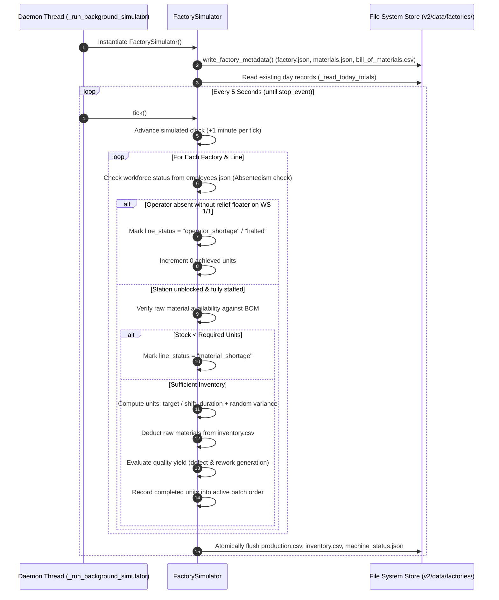
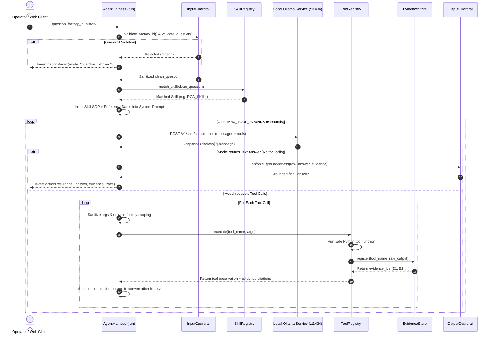
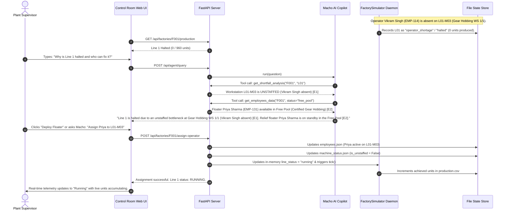

# FactoryOS V2: Technical Architecture & System Specification

**Autonomous Industrial Operations Intelligence, Discrete Physical Simulation, and Local Ollama ReAct Copilot (Macho)**

---

## Document Metadata

| Attribute | Specification |
|---|---|
| **Architecture Version** | FactoryOS V2.0 (Production Core Specification) |
| **Local Reasoning Backend** | Ollama LLM (`llama3.2` / `mistral` / `qwen3`) via `http://127.0.0.1:11434` |
| **Simulation Engine** | 5-Second Discrete-Time Multi-Workstation State Machine |
| **Knowledge Engine** | ChromaDB + BM25 Hybrid RAG with Tenant-Scoped Metadata Filtering |
| **Safety & Verification** | Tri-Tier Guardrails (Input Sanitization, Tool Allowlisting, Evidence Grounding `[E#]`) |

---

## 1. Executive Summary & Global Architecture Overview

FactoryOS V2 is an autonomous operations intelligence platform built for discrete manufacturing floors (automotive components, precision gearing, aerospace sub-assemblies). It bridges physical telemetry and autonomous operational action by pairing a **5-second discrete-time simulation engine** with an autonomous on-premise operations copilot (**Macho**):

1. **100% Local & Private:** Powered strictly by local **Ollama** models inside the plant firewall with zero cloud data transmission.
2. **Deterministic Evidence Grounding:** Every claim is verified against runtime telemetry indexed as `[E1]`, `[E2]`, etc.
3. **Autonomous Operational Actions:** Macho performs real floor mutations (e.g., querying the standby Free Pool and deploying certified relief floaters to halted workstations).
4. **Multi-Batch Scheduling:** Coordinates sequential multi-order customer contracts, automatically tracking quotas and enabling 1-click batch changeovers.

### Global System Topology

```mermaid
graph TB
    subgraph Client_Layer ["Client Layer (UI / Operator)"]
        UI["Web Frontend (Vanilla JS / CSS)<br/>- Live Floor Telemetry<br/>- Interactive Line Routes<br/>- Macho Copilot Drawer"]
    end

    subgraph API_Layer ["API Gateway & Controller (v2/api.py)"]
        FASTAPI["FastAPI App (port 8001)"]
        LIFESPAN["Lifespan Context Manager<br/>Daemon Thread Controller"]
        ROUTERS["REST Endpoints<br/>/production, /orders, /employees, /machines"]
        AGENT_EP["POST /api/agent/query"]
    end

    subgraph Simulation_Layer ["Discrete Physical Simulator (v2/simulator.py)"]
        SIM_DAEMON["FactorySimulator Daemon<br/>(5-sec Discrete Tick Loop)"]
        STATE_STORE["File-Backed Factory State Store<br/>(v2/data/factories/<FID>/<Date>/)<br/>- production.csv<br/>- machine_status.json<br/>- machine_logs.jsonl<br/>- downtime.csv<br/>- inventory.csv<br/>- employees.json"]
    end

    subgraph Agentic_Cognitive_Layer ["Macho AI Reasoning & Runtime Engine"]
        GUARD_IN["Tier 1: Input Guardrail<br/>(v2/guardrails.py)"]
        SKILL_ROUTER["Skill Registry & SOP Router<br/>(v2/skills/__init__.py)"]
        HARNESS["AgentHarness ReAct Engine<br/>(v2/harness.py)"]
        SUPERVISOR["Multi-Agent Supervisor<br/>(v2/multi_agent/__init__.py)"]
        GUARD_OUT["Tier 3: Output Guardrail<br/>(v2/guardrails.py)"]
        EVIDENCE["EvidenceStore [E1, E2,...]<br/>(v2/tools.py)"]
    end

    subgraph Tools_And_Retrieval ["Tool Execution & Knowledge Retrieval"]
        REGISTRY["ToolRegistry Dispatcher<br/>(v2/tools.py)"]
        OP_TOOLS["Operational Telemetry Tools<br/>- get_production_data<br/>- get_shortfall_analysis<br/>- get_employees_data<br/>- assign_floater"]
        RAG["Hybrid RAG Retriever<br/>(v2/rag.py)<br/>- ChromaDB Cosine Embeddings<br/>- BM25 Lexical Keyword Engine"]
        SOP_DOCS[("SOPs & Factory Manuals<br/>docs/factories/*.md")]
    end

    subgraph Local_LLM ["Local Inference Boundary"]
        OLLAMA["Local Ollama Service (:11434)<br/>llama3.2 / mistral / qwen3<br/>100% Private / Zero Cloud Leakage"]
    end

    UI -->|HTTP GET/POST| FASTAPI
    FASTAPI --> LIFESPAN
    LIFESPAN -->|Spawns Background Thread| SIM_DAEMON
    SIM_DAEMON -->|Mutates State Every 5s| STATE_STORE
    FASTAPI --> ROUTERS
    ROUTERS -->|Reads / Updates| STATE_STORE
    FASTAPI --> AGENT_EP

    AGENT_EP --> GUARD_IN
    GUARD_IN -->|Sanitized Question| SKILL_ROUTER
    SKILL_ROUTER -->|Injects SOP| HARNESS
    AGENT_EP -.->|Optional Supervisor Mode| SUPERVISOR

    HARNESS <-->|ReAct Loop (Prompt + Tools)| OLLAMA
    HARNESS -->|Dispatches Tool Calls| REGISTRY
    REGISTRY --> OP_TOOLS
    REGISTRY --> RAG
    OP_TOOLS -->|Queries / Mutates| STATE_STORE
    RAG -->|Indexes / Searches| SOP_DOCS
    OP_TOOLS & RAG -->|Registers Findings| EVIDENCE
    EVIDENCE -->|Supplies Indexed [E#] Data| HARNESS
    HARNESS --> GUARD_OUT
    GUARD_OUT -->|Grounding-Verified Answer| AGENT_EP
```

---

## 2. Discrete-Time Physical Simulation Engine (`v2/simulator.py`)

The simulator provides ground-truth manufacturing telemetry. It models 3 facilities (`F001` Automotive Components, `F002` Precision Textiles, `F003` Advanced Electronics) running continuous production lines composed of ordered workstations.

### Core Dataclasses
* `FactorySpec`: Encapsulates plant metadata, lines, materials, and failure profiles.
* `LineSpec`: Encapsulates sequential workstation pipelines, daily targets, and Bill of Materials (BOM).
* `MachineSpec`: Individual machine properties (`L01-M01` to `L01-M06`), codes, and workstation indices (`WS 1/1`).
* `MaterialSpec` & `MaterialRequirement`: Raw component inventory, safety thresholds, and consumption rates.

### Simulation Tick Loop Pipeline



---

## 3. High-Performance REST API Gateway (`v2/api.py`)

FastAPI coordinates incoming client requests, manages background threads, and exposes operational query and mutation endpoints:

* `lifespan(app)`: An `@asynccontextmanager` initializing `_sim_thread` as an in-process background daemon executing `_run_background_simulator()`. Signals `_sim_stop_event` on application shutdown.
* `GET /api/factories/{id}/production`: Real-time line throughput, target units, shortfall, and line status.
* `GET /api/factories/{id}/employees`: Shift attendance roll-call, machine operator assignments, absent personnel, and standby Free Pool floaters.
* `POST /api/factories/{id}/assign-operator`: Transfers an eligible floater to an unstaffed machine, updates `employees.json`, `machine_status.json`, and `production.csv`, and triggers an immediate simulator tick.
* `POST /api/factories/{id}/unassign-operator`: Returns a floater to the Free Pool and restores the unstaffed station state.
* `POST /api/factories/{id}/orders/dispatch-next`: Activates the next queued multi-batch contract.
* `POST /api/agent/query`: Dispatches user natural-language questions to the ReAct agent harness.

---

## 4. Autonomous Agent Execution Harness & ReAct Loop (`v2/harness.py`)



---

## 5. Tool Registry & Evidence Engine (`v2/tools.py`)

All model tool interactions are restricted to an allowlist of pure Python functions:

| Tool Name | Scope & Capabilities | Target Source |
|---|---|---|
| `get_shortfall_analysis` | Correlates missed targets with staffing bottlenecks, downtime, and material stock | `production.csv`, `downtime.csv`, `employees.json` |
| `get_employees_data` | Workforce attendance, line operators, absent staff, and standby Free Pool candidates | `employees.json` |
| `assign_floater` | Deploys a certified relief operator from the Free Pool to an unstaffed machine | `employees.json`, `machine_status.json` |
| `get_production_data` | Line throughput, daily targets, and shortfall metrics | `production.csv` |
| `get_downtime_data` | Machine stoppage logs, duration in minutes, and failure reason codes | `downtime.csv` |
| `get_machine_logs` | Historical lifecycle events, service dates, repairs, and sensor transitions | `machine_logs.jsonl` |
| `get_orders_data` | Multi-day batch contracts, cumulative units completed, and queue schedule | `orders.json` |
| `get_inventory_data` | Warehouse stock, consumption rates, and reorder alerts | `inventory.csv` |
| `get_quality_data` | First-pass yield, rework units, and scrap rejection counts | `quality.csv` |
| `get_machine_status` | Live operational status (running, down, idle, unstaffed) | `machine_status.json` |
| `search_factory_documents` | Hybrid RAG retrieval across SOP manuals and safety checklists | `docs/factories/*.md` |

Every tool result is indexed in `EvidenceStore` with an incremental citation ID (`[E1]`, `[E2]`). Claims made by the model must cite these tags.

---

## 6. Hybrid RAG Subsystem (`v2/rag.py`)

* **Document Loader:** Ingests plant SOPs, restart checklists, and manuals from `docs/factories/`.
* **Semantic Chunking:** Splits markdown by paragraphs with token overlap (`max_chars=600`, `overlap=100`).
* **Dense Vector Search:** Uses `OllamaChromaEmbeddingFunction` to compute embeddings via local Ollama `/api/embeddings` with cosine distance indexing.
* **Lexical BM25 Fallback:** Zero-dependency keyword matching for exact equipment part numbers and codes.
* **Multi-Tenant Scoping:** Filters queries by `where={"factory_id": {"$in": [factory_id, "shared"]}}`.

---

## 7. Tri-Tier Guardrails (`v2/guardrails.py`)

1. **Input Guardrail:** Validates factory ID formatting, blocks prompt injection heuristics, and enforces domain relevance.
2. **Execution Guardrail:** Verifies that requested tools exist in the allowlisted schema and sanitizes arguments.
3. **Output Guardrail:** Validates that citations cited in the final answer exist in the `EvidenceStore`, suppressing hallucinated brackets.

---

## 8. Dynamic Skill Playbooks (`v2/skills/__init__.py`)

* `RCA_SKILL`: Structured 5-Whys methodology prioritizing staffing bottlenecks before searching for mechanical faults. Direct 2-line response format.
* `WORKFORCE_SKILL`: Roll-call attendance analysis, unstaffed workstation detection, and floater dispatch.
* `INVENTORY_SKILL`: Evaluates BOM starvation and safety buffer levels.
* `MAINTENANCE_SKILL`: Evaluates equipment telemetry, repair timestamps, and restart checklists.
* `DAY_COMPARISON_SKILL`: Day-on-day shift variance and target deltas.

---

## 9. Hierarchical Multi-Agent Supervisor (`v2/multi_agent/__init__.py`)

`SupervisorAgent` decomposes broad operational queries and orchestrates 5 domain specialists:
1. **Production Specialist:** Throughput, shift attainment, and shortfall analysis.
2. **Workforce Specialist:** Attendance, line operators, absentees, and Free Pool standby floaters.
3. **Maintenance Specialist:** Machine telemetry, downtime reasons, and repair procedures.
4. **Inventory Specialist:** Raw materials stock and reorder thresholds.
5. **Quality Specialist:** Defect rates, rework units, and scrap.

---

## 10. Autonomous Remediation Workflow: Unstaffed Bottleneck Resolution


